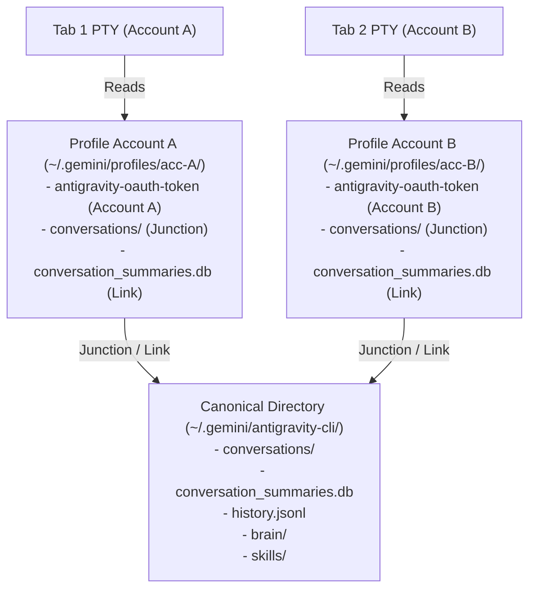

# Design Spec: Antigravity Multi-Account Process Isolation, Unified Conversations & Reactive Quota Sync

**Date:** 2026-10-17  
**Status:** Approved  
**Author:** Pair Programming Session (Geko & Antigravity)  

---

## 1. Overview & Problem Statement

Orca provides a native multi-account vault for the Antigravity CLI (`agy`), allowing users to register multiple Google accounts with different quota allocations (e.g., personal, work, secondary). However, users encounter three critical bugs in production:

1. **Session Account Overwrite on Restart (PTY Race Condition):**  
   When Orca restarts with multiple tabs belonging to different Antigravity accounts, all tabs reopen with whichever account was selected last. During cold restore, Orca initiates PTY spawns in parallel. Each tab executes `prepareAntigravityAccountForLaunch`, which writes to the single, operating-system-wide credential target (`gemini:antigravity` in Windows Credential Manager or macOS Keychain). Whichever tab writes last wins; by the time the asynchronous shell processes actually initialize and launch `agy`, they all read the overwritten global credential.
2. **Status Bar Badge Freezing or Desync:**  
   The Antigravity account badge in the status bar frequently freezes on one account, shows the wrong account, or fails to update when switching tabs. This occurs because [`useActiveWindowAntigravityAccount`](file:///D:/Workspaces/orca-upstream/src/renderer/src/hooks/useAntigravityAccounts.ts#L131-L156) searches exclusively in `s.tabsByWorktree` (legacy terminal tabs) instead of checking Orca's modern unified tabs (`s.unifiedTabsByWorktree` / `s.getTab()`) or focused split panes (`s.activePaneId`). As a result, it continuously falls back to the vault's globally selected account.
3. **Stale / Non-Reactive Quota across Accounts:**  
   The background rate-limit service only probes the single active OS keyring account via `agy -p /usage`. Secondary accounts in the vault are never queried during background cycles. Furthermore, when `recordUsageSnapshot()` saves usage data to disk in the main process, no IPC event is dispatched to the renderer, leaving the UI with stale or null usage figures until manual interaction.

### Goals
- **Parallel Process Isolation:** Each tab/session runs with its explicit `launchAccountId` without writing to or mutating the global OS keyring slot.
- **100% Unified Conversations & History:** All conversations, session transcripts, search indexes, command histories, and custom skills remain completely shared across all accounts and tabs.
- **Independent & Reactive Quota:** Measure fresh quota for *all* configured Antigravity accounts in background cycles without spending model turn quota, pushing updates reactively to the renderer.
- **Accurate Active Account Status:** The status bar badge and quota meter immediately reflect the focused tab and split pane's active account.

---

## 2. Architecture & File Layout

### 2.1 Canonical Central Repository (Single Source of Truth)
To ensure all conversations, chat summaries, and custom skills are shared across all accounts, the canonical system directory remains the sole persistent data store:
- **Canonical Path:** `~/.gemini/antigravity-cli/`
  - `conversations/` — Contains all conversation turn logs and transcripts across all sessions.
  - `conversation_summaries.db` (plus `-shm` and `-wal`) — SQLite database maintaining titles, timestamps, and search metadata for all chats.
  - `history.jsonl` — Unified CLI prompt and command history.
  - `brain/` — Generated conversation artifacts.
  - `skills/` & `mcp/` — Custom skills, tools, and shared MCP server configurations.

### 2.2 Account Profile Isolation
For each account configured in Orca's encrypted vault (`userData/antigravity-accounts/vault`), Orca manages an account profile directory:
- **Profile Path:** `~/.gemini/profiles/<accountId>/.gemini/antigravity-cli/`
- **Transparent Enclosure via Filesystem Junctions / Symlinks:**
  - `conversations/` ➔ *NTFS Junction* (Windows) / *POSIX Directory Symlink* (macOS/Linux) pointing to the canonical `~/.gemini/antigravity-cli/conversations/`.
  - `brain/`, `skills/`, `mcp/` ➔ *NTFS Junctions* / *POSIX Symlinks* pointing to canonical directories.
  - `conversation_summaries.db` & `history.jsonl` ➔ *Hard links* (or file symlinks) pointing to canonical files.
- **Isolated Account Secret:**
  - `antigravity-oauth-token` — JSON file containing `{ auth_method: "oauth", token: { access_token, refresh_token, id_token, ... } }` exclusive to `<accountId>`.

---

## 3. PTY Launch Pipeline & Concurrency Safety

### 3.1 PTY Environment Injection (`src/main/ipc/pty/ipc/spawn-env.ts`)
When `assemblePtyIpcSpawnEnv` prepares the PTY environment for an Antigravity tab:
1. `prepareAntigravityAccountForLaunch` receives `launchAccountId`.
2. Orca invokes `AntigravityProfileManager.ensureProfile(launchAccountId)`:
   - Verifies profile directory and links exist.
   - Synchronizes `antigravity-oauth-token` with the latest decrypted token from `vault.accounts`.
3. Injects file-storage credential authority into the spawned PTY process environment (`args.env`):
   - Points configuration authority to the account's profile directory.
   - Configures file-backed authentication mode so `agy` bypasses the OS keyring.
4. **Result:**
   - Multiple tabs launching simultaneously on Orca restart read their isolated profile tokens concurrently.
   - The OS keyring (`gemini:antigravity`) is **never modified** during tab launches, completely eliminating startup race conditions.

### 3.2 Account Deletion & Fallback Safety (`src/main/antigravity/native-account-launch.ts`)
If a restored tab has a `launchAccountId` that was deleted from the vault:
- `prepareAntigravityAccountForLaunch` detects that `vault.accounts.find(a => a.id === launchAccountId)` is missing.
- It safely degrades to the vault's default active account (`vault.selectedAccountId`) or the canonical environment without throwing or interrupting PTY spawn.

---

## 4. Multi-Account Rate-Limit Background Probing & Reactive Sync

### 4.1 Independent Account Quota Probing (`src/main/rate-limits/antigravity-usage-fetcher.ts`)
- Implements `fetchAntigravityAccountRateLimits({ accountId, profileDir, ... })`:
  - Executes `agy -p /usage` within the account's profile environment.
  - Takes ~2 seconds and consumes 0 prompt/model tokens.
  - Returns `ProviderRateLimits` containing:
    - Gemini Models (5-hour and weekly limits)
    - Claude & GPT models (5-hour and weekly limits)
    - Model reset timestamps (`resetsAt`)

### 4.2 Background Service Polling (`src/main/rate-limits/service/service-full-cycle-application.ts`)
- During the background rate-limit refresh cycle:
  - Iterates over all accounts in `vault.accounts`.
  - Runs quota probes in bounded batches.
  - Durably records snapshots via `accountService.recordUsageSnapshot(account.id, usage)`.
  - Dispatches an IPC notification (`antigravity-accounts-changed`) to all renderer windows.

### 4.3 Reactive Renderer Synchronization (`src/renderer/src/hooks/useAntigravityAccounts.ts`)
- Subscribes to the `antigravity-accounts-changed` IPC event.
- When notified, updates `cachedState` and triggers all registered listeners.
- The status bar, account switcher menu, and settings panel update their usage bars and countdowns immediately without user interaction.

---

## 5. Status Bar & Active Tab Resolution

### 5.1 Deterministic Resolution Hierarchy
In `src/renderer/src/hooks/useAntigravityAccounts.ts`, rewrite `useActiveWindowAntigravityAccount` to follow a robust resolution hierarchy:

1. **Focused Split Pane (`s.activePaneId`):**  
   If the user is interacting with a specific terminal pane in a split layout, check whether that pane has `launchAgent === 'antigravity'` and `launchAccountId`. If so, return that account.
2. **Active Unified Tab (`s.unifiedTabsByWorktree` / `s.getTab(s.activeTabId)`):**  
   If no split pane is focused, inspect the active unified tab. If `tab.launchAgent === 'antigravity'` and `tab.launchAccountId`, return that account.
3. **Legacy Tab Fallback (`s.tabsByWorktree`):**  
   Fall back to legacy terminal tab collections for backwards compatibility.
4. **Worktree / Global Default:**  
   If the active view is not an Antigravity session (e.g. Git view, editor), display the account bound to the active repository (`repo.antigravityAccountId`) or the vault's default `activeAccount`.

### 5.2 Status Bar Segment (`src/renderer/src/components/status-bar/StatusBarProviderSegment.tsx`)
- Reads the resolved account from `useActiveWindowAntigravityAccount()`.
- Updates `AntigravityStatusAccountBadge` with the active account's emoji and alias.
- Sets `effectiveLimits` directly to `displayedAccount.lastUsage`.
- When switching between tabs or split panes with different accounts, the badge and quota indicators update synchronously.

---

## 6. Error Handling & Edge Cases

| Scenario | Handling Strategy |
| :--- | :--- |
| **Account deleted in Settings** | Prune `~/.gemini/profiles/<accountId>` using `fs.unlinkSync` on links and `fs.rmdirSync`. **Never** delete canonical directory contents. |
| **Token revoked or expired** | Classify as `auth-expired` / `signed-out`. Mark status as `unavailable` with a user-facing action prompt. Avoid repeated retries. |
| **Missing canonical directories** | Automatically initialize canonical directory structure before creating filesystem junctions. |
| **NTFS Junctions on Windows** | Use `fs.symlinkSync(target, linkPath, 'junction')`, which requires no administrative privileges and is fully supported by Windows kernel. |
| **Non-Antigravity tabs** | Gracefully pass through without profile modification or environment pollution. |

---

## 7. Testing & Verification Plan

### 7.1 Unit Tests
- `src/main/antigravity/native-account-profile-manager.test.ts`:  
  Verify idempotent profile directory creation, junction linking, token synchronization, and safe cleanup.
- `src/main/rate-limits/antigravity-usage-fetcher.test.ts`:  
  Test multi-account probe invocation, parameter isolation, and quota response parsing.
- `src/renderer/src/hooks/useAntigravityAccounts.test.ts`:  
  Test `useActiveWindowAntigravityAccount` against active unified tabs (`unifiedTabsByWorktree`), split panes, legacy tabs, and fallback defaults.
- `src/renderer/src/components/status-bar/StatusBarProviderSegment.test.tsx`:  
  Verify badge and quota bar reactivity when switching between tabs configured with different accounts.

### 7.2 Integration & End-to-End Tests
- **Restart Race Simulation:**  
  Hydrate multiple tabs with distinct `launchAccountId` values in a test workspace session. Trigger concurrent PTY spawns and verify each process receives its designated account environment with zero cross-contamination.
- **Code Quality & Style Checks:**  
  - Typecheck: `pnpm tc`  
  - Code Quality & Changed Lint: `pnpm run check:code-quality:changed`  
  - Full Test Suite: `pnpm test`
