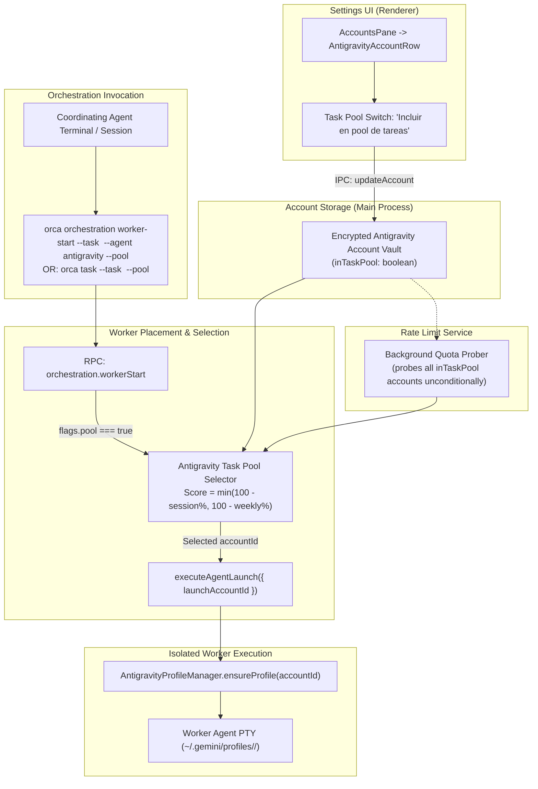

# Design Spec: Antigravity Task Pool & Multi-Account Orchestration

**Date:** 2026-10-19  
**Status:** Approved by Reviewer / Ready for User Approval  
**Author:** Pair Programming Session (Geko & Antigravity)  

---

## 1. Intent & The Why

Orca recently completed full multi-account process isolation for Antigravity (`agy`), enabling multiple Google accounts to run in parallel through independent profile directories (`~/.gemini/profiles/<accountId>/`) with symlinked history and shared conversations.

However, when agents inside Orca act as coordinators and dispatch sub-tasks in parallel (via Orca's orchestration subsystem), all workers currently default to whichever account is globally selected in the vault. This creates a critical bottleneck:
1. High-concurrency agent workflows quickly exhaust the 5-hour or weekly quota of a single account.
2. Available quota on secondary Antigravity accounts configured in the vault remains completely idle during parallel runs.
3. Agents have no structured mechanism to divide and balance usage across accounts.

**Intent:**  
Allow the user to designate a subset of Antigravity accounts as a "Task Pool" within Settings. When coordinating agents launch parallel tasks via Orca's CLI/orchestration layer with the `--pool` argument, Orca automatically assigns each worker the pool account with the highest available usage headroom (evaluating both the 5-hour session window and the 7-day weekly window).

---

## 2. Goals, Non-Goals & Anti-Goals

### 2.1 Goals
- **User-Managed Pool in Settings:** Users can toggle which Antigravity accounts participate in the task pool directly from the Settings > Accounts pane.
- **Persistent Pool Configuration:** Pool membership is durably persisted alongside account metadata in the encrypted Antigravity account vault (`inTaskPool: boolean`).
- **Quota-Aware Automatic Selection:** When an orchestration worker is spawned with `--pool`, the backend evaluates real-time reactive rate-limit telemetry across all pool accounts and selects the account with the greatest available quota margin considering both the 5-hour (`session`) and 7-day (`weekly`) windows.
- **CLI & Orchestration Integration:** Add the `--pool` flag to `orca orchestration worker-start` (and provide a convenient `orca task` alias).
- **Process Isolation on Worker Spawn:** The resolved account is passed as `launchAccountId` into the worker placement pipeline (`placeWorkerAgent` -> `executeAgentLaunch`), isolating the child agent's environment without mutating the active window account or other concurrent workers.
- **Agent Discovery & Preambles:** Update the dispatch preamble and orchestration skill guides so agents learn to invoke `--pool` when parallelizing work.

### 2.2 Non-Goals
- **Non-Antigravity Providers (Phase 1):** Claude, Codex, and OpenCode remain on their current launch configurations; pool distribution is scoped to Antigravity where multi-account profile isolation is already verified.
- **Manual Account Management in Workers:** Workers do not manage their own credentials or know account secrets; assignment is transparently handled by Orca.
- **Complex In-Flight Locks:** Accounts are not locked exclusively during a task; if an account has ample quota, multiple concurrent tasks can run on it without artificial gating (as confirmed by user requirements: *"Puede ser la misma o diferentes no importa"*).
- **Remote / Federated Workers (Phase 1):** `--pool` is local-only; `--on <remote>` combining with `--pool` is rejected with an explicit preflight error.

### 2.3 Anti-Goals
- **No Global Account Mutation:** Spawning a worker from the pool must never change the user's active interactive account in the main window or status bar.
- **No Silent Failures on Quota Depletion:** If all accounts in the pool are rate-limited or exhausted (100% consumed), the command must fail fast with a descriptive error indicating the earliest reset timestamp rather than launching a doomed worker.

---

## 3. Architecture & System Flow



---

## 4. Detailed Component Design

### 4.1 Vault & Account Summary Model
- In `src/shared/antigravity-account-types.ts`:
  - Extend `AntigravityAccountSummary` and `AntigravityAccountRecord`:
    ```ts
    export type AntigravityAccountSummary = {
      id: string
      email?: string
      alias?: string
      addedAt: number
      lastUsedAt?: number
      inTaskPool?: boolean // Flag indicating participation in the worker pool
    }
    ```
- In `src/main/antigravity/native-account-store.ts` & `native-account-service.ts`:
  - Support setting/toggling `inTaskPool` via account mutation methods.
  - Persist cleanly in the encrypted vault JSON structure.

### 4.2 Settings UI (`src/renderer/src/components/settings/`)
- In `AntigravityAccountRow.tsx`:
  - Add an "Incluir en pool de tareas" / "Task Pool" toggle switch using `@/components/ui/switch` and `@/components/ui/badge`.
  - When active, display a subtle badge (`bg-primary/10 text-primary border-primary/20`) indicating the account is active in the worker pool.
  - Style strictly per `docs/STYLEGUIDE.md`:
    - Clean inline layout beside the existing edit/delete controls.
    - Tabular text with muted labels (`text-[11px] text-muted-foreground`).

### 4.3 Quota Evaluation & Selection Algorithm
- File: `src/main/antigravity/antigravity-task-pool-selector.ts`
- Logic:
  1. Retrieve all accounts from vault where `inTaskPool === true`.
  2. If none configured:
     - Throw `OrchestrationError('invalid_argument', 'No Antigravity accounts are configured in the Task Pool. Enable at least one account in Settings > Accounts.')`.
  3. For each candidate account, inspect its latest `ProviderRateLimits` from the rate-limit cache:
     - Session Window (5h): `usedSession = rateLimits?.session?.usedPercent ?? 0`
     - Weekly Window (7d): `usedWeekly = rateLimits?.weekly?.usedPercent ?? 0`
     - Status check: If `rateLimits?.status === 'rate-limited'` or `usedSession >= 100` or `usedWeekly >= 100`, mark as currently exhausted.
     - Headroom calculation:
       $$\text{Headroom} = \min(100 - \text{usedSession}, 100 - \text{usedWeekly})$$
     - *Missing Telemetry Handling (Builder Call):* If an account in the pool has not yet been probed (no snapshot in cache), assume optimistic headroom (100%) and trigger an asynchronous background probe so future dispatches have fresh data without stalling the current launch turn.
  4. If all accounts are exhausted:
     - Determine the earliest reset timestamp across candidate accounts (`resetsAt`).
     - Throw `OrchestrationError('resource_exhausted', 'All accounts in the Antigravity Task Pool have reached their usage limits. Earliest reset at: <timestamp>.')`.
  5. Select the account with the maximum Headroom ($\text{argmax}(\text{Headroom})$).
     - *Tie Breaking & Concurrency (Builder Call):* Ties are broken by least recently assigned (`lastUsedAt`), rotating naturally among accounts with identical headroom.
  6. Record `lastUsedAt = Date.now()` on the winning account and return `selectedAccountId`.

### 4.4 RPC & CLI Integration
- In `src/shared/rpc-contract/orchestration-worker-start-params.ts`:
  - Add `pool: z.boolean().optional()` to `WorkerStartParams`.
- In `src/cli/specs/orchestration-worker-specs.ts`:
  - Add `'pool'` to `allowedFlags` for `orchestration worker-start`.
  - Document `--pool` in notes:
    - `"When --pool is specified with --agent antigravity, Orca automatically assigns the account from your configured Task Pool with the most available quota across 5h and weekly windows."`
- In `src/cli/handlers/orchestration/worker-launch-handler.ts`:
  - Forward `pool: getOptionalBooleanFlag(flags, 'pool')` into `orchestration.workerStart`.
- In `src/cli/specs/index.ts` & `handler-group-manifest.ts`:
  - Register `orca task` as an alias mapping directly to `orchestration worker-start` for convenience.
- In `src/main/runtime/rpc/methods/orchestration/worker/workers.ts` & `local-worker-start.ts`:
  - If `params.pool === true`:
    - *Remote Guard (Builder Call):* If `params.on` is present, reject immediately: `throw new OrchestrationError('invalid_argument', '--pool is only supported for local worker execution.')`.
    - *Agent Defaulting (Builder Call):* If `params.agent` is omitted, default to `'antigravity'`. If `params.agent` is passed and is not `'antigravity'`, reject with `invalid_argument`.
    - Invoke `selectAntigravityPoolAccount()`.
    - Pass the returned `accountId` as `launchAccountId` into `placeWorkerAgent` and `executeAgentLaunch`.

### 4.5 Rate Limit Probing Decoupling
- In `src/main/rate-limits/service/`:
  - Ensure that background rate-limit probing cycles include all accounts where `inTaskPool === true`, even if the user has omitted the Antigravity widget from their status bar layout.

### 4.6 Agent Preamble & Skill Documentation
- In `src/main/runtime/orchestration/preamble.ts` (`buildSubDispatchSection`):
  - Update the sub-dispatch instruction snippet:
    ```sh
    orca orchestration worker-start --task <task_id> --worktree current --agent antigravity --pool --json
    ```
  - Explain inline that `--pool` distributes parallel sub-tasks across available Google accounts to prevent rate-limiting.
- In `src/cli/bundled-skill-guides.ts` (`orchestration` skill):
  - Document the `--pool` option under the coordinator loop guidance.

---

## 5. Architectural Calls Made by Builder Check

1. **Concurrency & Load Balancing:** As confirmed in requirements (*"Puede ser la misma o diferentes no importa"*), selection is stateless $\text{argmax}(\text{Headroom})$ with tie-breaking on `lastUsedAt`. No complex in-flight ledger or artificial blocking is introduced.
2. **Missing Telemetry Policy:** Accounts without cached quota are treated optimistically with 100% headroom to prevent blocking worker launch, and an asynchronous refresh is queued.
3. **Remote Worker Scope:** `--pool` is scoped to local execution in Phase 1; passing `--on` alongside `--pool` fails fast with `invalid_argument`.
4. **Agent Defaulting:** Passing `--pool` without `--agent` automatically defaults `--agent antigravity`; passing `--pool` with an incompatible agent is rejected.

---

## 6. Verification & Test Plan

1. **Unit Tests:**
   - `antigravity-task-pool-selector.test.ts`:
     - Selects account with higher 5h headroom when weekly is equal.
     - Selects account with higher weekly headroom when 5h is equal.
     - Correctly identifies limiting bottleneck using `min()`.
     - Skips rate-limited and 100% full accounts.
     - Throws informative error with earliest reset time when all accounts are exhausted.
     - Throws actionable error when no accounts are in the pool.
     - Handles unprobed accounts optimistically without throwing.
   - `orchestration-worker-start.test.ts`:
     - Verifies `--pool` flag is parsed and forwarded to RPC.
     - Verifies `launchAccountId` is passed to `executeAgentLaunch`.
     - Verifies `--pool` with `--on` throws `invalid_argument`.
     - Verifies `--pool` defaults `--agent antigravity`.
2. **Typecheck & Linting:**
   - `pnpm tc` passes with 0 errors across main, renderer, and cli.
   - `pnpm run check:code-quality:changed` passes styleguide lint rules.
3. **End-to-End Execution Test:**
   - Configure 2 accounts in the Task Pool.
   - Run `orca orchestration worker-start --spec "test" --pool --json` (or `orca task --spec "test" --pool --json`).
   - Verify worker spawns with isolated profile matching the highest-quota account.
